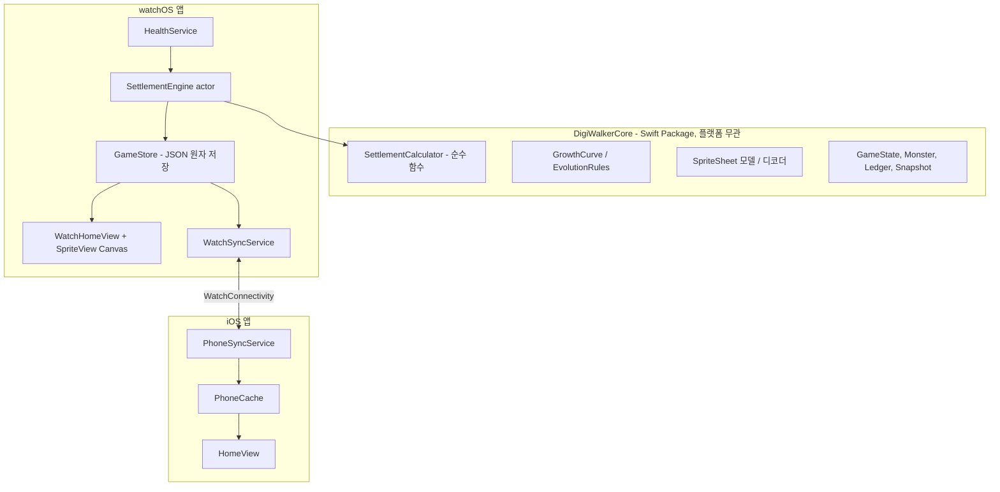

# DigiWalker — iOS + watchOS 걸음 기반 도트 몬스터 육성 게임 설계서

> 버전: 1.1
> 작성일: 2026-11-22
> 대상: iPhone + Apple Watch 연동형 컬러 도트 몬스터 육성 게임
> 배포 범위: **개발자 본인 기기 전용** (비공개·비상업)
> 상태: 구현 전 설계 / 1차 MVP 개발 기준

### 변경 이력

| 버전 | 날짜 | 내용 |
|---|---|---|
| 1.0 | 2026-11-22 | 최초 설계서 (Digital Monster Walker) |
| 1.1 | 2026-11-22 | 설계 검토(Claude + Codex 교차 분석) 반영. 본인 기기 전용 배포, 컬러 도트 데이터 렌더링, 정산 구간·누락일·중복 방지 재설계, 동기화 epoch, 성장 곡선, MVP에 첫 진화 포함, 에셋 팩 분리 |

---

## 1. 프로젝트 개요

### 1.1 게임 콘셉트

Apple Watch에서 컬러 도트 몬스터를 육성하고, 실생활의 **걸음 수**를 성장 자원으로 전환하는 육성 게임이다. iPhone에서는 몬스터 상태와 진화 내역을 확인한다. 이동거리·GPS 탐험·알/아이템은 후속 단계에서 확장한다.

**기본 플레이 루프**

1. Apple Watch에서 파트너 몬스터를 확인한다.
2. 일상에서 걸으면 Apple Health에 활동 기록이 축적된다.
3. 앱을 열면 놓친 기간까지 포함해 **중복 지급 없이** 경험치를 정산한다.
4. 몬스터가 레벨업하고, 정해진 레벨에 도달하면 **진화(외형 변화)** 한다.
5. 화면에 "다음 진화까지 남은 걸음"을 보여주어 다시 걸을 이유를 만든다.
6. iPhone에서 상태와 진화 내역을 본다.
7. (2차) 탐험 모드에서 새 장소를 방문하면 알·아이템을 발견한다.

### 1.2 플랫폼별 역할

| 구성 요소 | 책임 | 비고 |
|---|---|---|
| watchOS 앱 | 도트 몬스터 표시, HealthKit 조회, 정산, 로컬 저장 | MVP에서 **육성 데이터 원본** |
| iOS 앱 | 몬스터 상태·진화 내역 조회 | MVP에서는 읽기 전용 캐시 |
| WatchConnectivity | 워치→아이폰 최신 스냅샷 전달 | 항상 연결된 것은 아님 |
| Spring Boot 서버 / MariaDB | 계정·백업·탐험 보상 검증 | 3차, 1차 구현 제외 |

### 1.3 핵심 설계 원칙

- **오프라인 우선**: 워치가 iPhone과 연결되지 않아도 육성 상태와 정산 기록을 저장한다.
- **중복 지급 방지**: 동일 활동량을 여러 번 XP로 환산하지 않는다. 정산 구간은 서로 겹치지 않는 절대 시각 구간으로 고정한다.
- **권한 최소화**: MVP는 걸음 수 읽기만 요청한다. 거리·위치는 해당 기능 도입 시 요청한다.
- **배터리 우선**: 상시 GPS를 사용하지 않는다. Always On 화면에서는 애니메이션을 멈춘다.
- **규칙과 플랫폼 분리**: 정산·성장 규칙은 HealthKit/UI와 분리된 순수 함수로 작성해 단위 테스트하고, 추후 서버로 이전할 수 있게 한다.
- **에셋 분리**: 몬스터 도트 데이터는 코드와 분리된 "에셋 팩"으로 관리한다(§8, §14).

---

## 2. 개발 범위와 로드맵

### 2.1 1차 MVP — 반드시 완성할 기능

- [ ] Xcode에서 iOS 앱 + 연결된 watchOS 앱 타깃 생성, 무료 Personal Team 서명으로 본인 기기 설치
- [ ] **HealthKit capability가 무료 계정에서 추가·동작하는지 첫 단계에서 확인**
- [ ] 컬러 도트 스프라이트 데이터 포맷 + `Canvas` 렌더러 (32×32, 정수 배율)
- [ ] 2~3프레임 대기 애니메이션 (Always On에서는 정지 프레임)
- [ ] 온보딩에서 HealthKit 걸음 수 읽기 권한 요청, 온보딩 시각 기록
- [ ] 정산 엔진: 고정 시간대의 일 단위 구간, 누락일 일괄 정산, 최근 구간 재조회, 최대값 유지, 직렬 커밋
- [ ] 성장 곡선 기반 레벨 계산
- [ ] **첫 진화 1회** (유년기 → 성장기) 및 진화 연출(간단한 프레임 전환)
- [ ] 워치 화면: 몬스터, 레벨, XP 진행 바, 오늘 걸음, 다음 진화까지 남은 걸음
- [ ] 게임 상태 JSON 원자적 저장 (Application Support)
- [ ] WatchConnectivity: epoch + revision 스냅샷, 활성화/재진입 시 재발행
- [ ] iPhone 화면: 이름·단계·레벨·XP·누적 인정 걸음·마지막 동기화 시각
- [ ] 앱 재실행, 재설치(덮어쓰기), 페어링 연결 해제·복귀 테스트

**MVP 완료 조건**

1. 애플워치에서 실제 걸음 수를 읽어 XP가 적립되고, 재실행·덮어쓰기 재설치 후에도 보존된다.
2. 며칠 앱을 열지 않아도, 다음 실행 시 빠진 날짜가 정산된다.
3. 같은 기록을 다시 읽거나 정산을 동시에 두 번 호출해도 XP가 늘지 않는다.
4. 첫 진화를 실제로 경험할 수 있다 (약 1만 보 이내).
5. 아이폰이 연결 복귀 후 최신 상태를 표시하고, 오래된 값은 오래된 값임을 표시한다.

### 2.2 2차 — 콘텐츠 확장

- 진화 단계 확장(성숙기 이후), 분기 진화 조건(누적 거리, 연속 달성일 등)
- 워치 컴플리케이션 / Smart Stack 위젯에 몬스터 표시 (리텐션 핵심)
- `distanceWalkingRunning` 도입 — 진화·업적 조건 전용 (XP 원천 아님)
- 돌봄 요소 검토(컨디션·배고픔 등), 다중 몬스터 보유
- Core Location 기반 탐험 시작/종료, 구역 도착 판정, 알·아이템 지급
- iPhone 도감·진화 트리·인벤토리 UI
- PNG → 스프라이트 데이터 변환 스크립트

### 2.3 3차 — 서버·계정

- Spring Boot REST API + MariaDB, 계정·백업·복구
- 탐험 보상 서버 검증, 정산 멱등키
- 배포 범위 확대 여부 재검토 (§14 — 에셋 교체 선행 필요)

---

## 3. 개발 환경 및 배포

### 3.1 권장 환경

- macOS + 최신 안정 버전 Xcode, Swift 6, SwiftUI
- 개발용 iPhone + 페어링된 Apple Watch Ultra 2
- 최소 지원: **iOS 18 / watchOS 11** (본인 기기 전용이므로 최신 API 사용: Observation, `HKStatisticsQueryDescriptor`, Swift Testing)

### 3.2 새 프로젝트 만들기

1. Xcode → File → New → Project → iOS App. Product Name `DigiWalker`, SwiftUI, Swift.
2. File → New → Target → watchOS App (iOS 앱과 연결).
3. 두 타깃의 Signing Team을 **Personal Team(무료 Apple 계정)** 으로 설정.
4. 공유 로직은 로컬 Swift Package(`DigiWalkerCore`)로 분리해 두 타깃이 의존하게 한다. 플랫폼 SDK(HealthKit, WatchConnectivity) import는 앱 타깃에만 둔다. 패키지는 `swift test`로 Mac에서 바로 테스트할 수 있다.
5. 워치 타깃에 HealthKit capability와 `NSHealthShareUsageDescription` 추가.

### 3.3 본인 기기 배포 (무료 계정)

- 설치: Xcode에서 실제 Watch를 실행 대상으로 선택하고 ⌘R.
- **서명 유효기간 7일**: 만료되면 앱이 실행되지 않는다. 7일 안에 Xcode에서 다시 ⌘R로 **덮어쓰기 설치**한다.
- **앱을 삭제하지 않는다**: 덮어쓰기 설치는 로컬 데이터(정산 원장·XP)를 보존하지만, 삭제하면 워치 원본 데이터가 사라진다.
- 기기에 개발자 모드가 필요하면 활성화한다. 워치는 페어링된 iPhone을 통해 무선으로 설치·디버깅된다.
- 재서명이 번거로워지면 유료 Apple Developer Program(1년 유효)으로 전환한다. 지인 배포가 필요해지면 TestFlight 내부 테스터 또는 Ad Hoc을 검토한다(§14 선행).

---

## 4. 전체 아키텍처



### 4.1 디렉터리

```text
DigiWalker/
├── DigiWalker.xcodeproj
├── Packages/DigiWalkerCore/
│   ├── Sources/DigiWalkerCore/
│   │   ├── Models/        GameState, Monster, DayLedger, MonsterSnapshot
│   │   ├── Settlement/    SettlementCalculator, SettlementWindow
│   │   ├── Growth/        GrowthCurve, EvolutionRules
│   │   └── Sprites/       SpriteSheet, SpritePack, Palette
│   └── Tests/DigiWalkerCoreTests/
├── iOSApp/
│   ├── Views/HomeView.swift
│   ├── Services/PhoneSyncService.swift
│   └── Storage/PhoneCache.swift
├── WatchApp/
│   ├── Views/WatchHomeView.swift, SpriteView.swift, OnboardingView.swift
│   ├── Services/HealthService.swift, SettlementEngine.swift, WatchSyncService.swift
│   └── Storage/GameStore.swift
├── Assets/StarterPack/    # 저장소 자체 제작 오리지널 몬스터 (커밋됨)
├── PrivateAssets/         # 개인용 에셋 팩 (gitignore, 커밋 금지)
└── docs/DESIGN.md
```

### 4.2 데이터 소유권

- **Watch 원본**: 정산 원장, 몬스터 XP·단계, 상태 epoch·revision.
- **Phone 캐시**: 마지막으로 받은 스냅샷과 수신 시각. iPhone은 XP를 계산하지 않는다.
- 워치 로컬 데이터만으로는 기기 교체·앱 삭제 시 복구가 불가능하다. MVP에서는 이를 **알려진 제약**으로 수용하고, 2차에서 iPhone 측 백업(스냅샷 + 원장 사본 보관 및 복원)을 검토한다.

---

## 5. 게임 데이터 모델

### 5.1 Monster

```swift
struct Monster: Codable, Identifiable, Sendable {
    var id: UUID
    var speciesId: String          // 에셋 팩의 종 ID
    var nickname: String
    var experience: Int            // 누적 XP (유일한 진실 값)
    var totalCreditedSteps: Int
    var evolutionHistory: [EvolutionRecord]

    var level: Int { GrowthCurve.level(for: experience) }   // 저장하지 않고 항상 계산
}

struct EvolutionRecord: Codable, Sendable {
    var fromSpeciesId: String
    var toSpeciesId: String
    var evolvedAt: Date
    var atLevel: Int
}
```

- `level`은 저장하지 않는다(v1.0에서는 저장값과 공식이 어긋날 수 있었음).
- 개체 ID(`id`)와 종 ID(`speciesId`)를 분리한다.

### 5.2 정산 원장

```swift
struct DayLedger: Codable, Sendable {
    var dayKey: String             // 정산 시간대 기준 "2026-11-22" (표시·식별용)
    var windowStart: Date          // 절대 시각 [start, end)
    var windowEnd: Date
    var creditedSteps: Int         // 지금까지 관측한 최대 걸음 수 (감소하지 않음)
    var creditedXP: Int            // 이 구간에 지급한 누적 XP (감소하지 않음)
    var lastQueriedAt: Date
}

struct GameState: Codable, Sendable {
    var schemaVersion: Int = 1
    var epoch: UUID                // 설치·초기화 세대 ID
    var revision: Int              // 상태 변경 시 증가
    var onboardedAt: Date          // 이 시각 이전 걸음은 인정하지 않음
    var settlementTimeZoneId: String  // 온보딩 시 고정, 여행 중에도 변경하지 않음
    var monster: Monster
    var ledgers: [String: DayLedger]  // dayKey → 원장
    var updatedAt: Date
}
```

### 5.3 동기화 스냅샷

```swift
struct MonsterSnapshot: Codable, Sendable {
    var schemaVersion: Int = 1
    var epoch: UUID
    var revision: Int
    var monsterId: UUID
    var speciesId: String
    var nickname: String
    var experience: Int
    var level: Int                 // 표시 편의용. 수신 측은 experience로 재계산해 검증 가능
    var totalCreditedSteps: Int
    var todaySteps: Int
    var stepsToNextEvolution: Int?
    var generatedAt: Date
}
```

MVP 스냅샷에는 거리 필드를 넣지 않는다(2차에 schemaVersion 2로 추가).

---

## 6. 경험치 및 성장 시스템

### 6.1 XP 규칙 (MVP)

| 이벤트 | 보상 | 단계 |
|---|---|---|
| 10걸음 | XP 1 | MVP |
| 레벨 5 도달 | 첫 진화 (유년기 → 성장기) | MVP |
| 누적 거리 조건 | 분기 진화 조건 | 2차 |
| 탐험 구역 최초 방문 | 알 또는 아이템 | 2차 |

- XP 단위를 **10보 = 1 XP**로 잘게 나눈다. v1.0의 100보 = 10 XP는 일별 내림 손실이 최대 99보였는데, 이를 9보로 줄인다.
- 걸음만 XP 원천이다. 거리는 같은 활동이므로 XP로 이중 환산하지 않는다.

### 6.2 성장 곡선

레벨이 오를수록 필요 XP가 늘어나는 2차 곡선을 쓴다.

```text
레벨 L 도달에 필요한 누적 XP = 50 × L × (L − 1)
```

| 레벨 | 누적 XP | 누적 걸음 | 하루 8,000보 기준 |
|---:|---:|---:|---|
| 2 | 100 | 1,000 | 첫날 |
| 5 | 1,000 | 10,000 | 1~2일 (**첫 진화**) |
| 10 | 4,500 | 45,000 | 약 6일 |
| 20 | 19,000 | 190,000 | 약 24일 |
| 30 | 43,500 | 435,000 | 약 54일 |

```swift
enum GrowthCurve {
    static let xpPerSteps = 10

    static func xp(forSteps steps: Int) -> Int { max(0, steps) / xpPerSteps }

    static func requiredXP(forLevel level: Int) -> Int { 50 * level * (level - 1) }

    static func level(for experience: Int) -> Int {
        var level = 1
        while requiredXP(forLevel: level + 1) <= experience { level += 1 }
        return level
    }
}
```

곡선의 상수는 1주일 동안 직접 플레이해 본 뒤 조정한다(§15.3).

### 6.3 진화 규칙 (MVP)

- 에셋 팩의 종 정의에 `evolvesTo`, `evolveAtLevel`을 둔다.
- 정산 커밋 시 레벨이 `evolveAtLevel` 이상이 되면 종을 바꾸고 `EvolutionRecord`를 남긴다.
- 진화는 정산 결과로 결정되므로 앱이 꺼져 있던 동안 조건을 넘었어도 다음 실행 시 1회 적용된다. 진화 연출은 "아직 보여주지 않은 진화"가 있을 때 화면에서 한 번 재생한다.

### 6.4 정산 알고리즘

**정산 구간**

- 온보딩 시 `settlementTimeZoneId`를 고정한다. 하루 구간은 그 시간대의 자정~자정이며, DST는 `Calendar`로 계산한다. 시간대를 고정하므로 여행으로 기기 시간대가 바뀌어도 구간이 겹치지 않는다.
- 첫 구간의 시작은 자정이 아니라 `onboardedAt`이다. 따라서 설치 이전 걸음은 인정하지 않는다.
- 모든 쿼리는 `.strictStartDate`를 사용한다. 각 샘플은 **시작 시각**이 속한 구간 하나에만 귀속되므로, 구간 경계를 걸친 샘플이 두 번 세어지지 않는다.

**정산 절차** (`SettlementEngine.reconcile()`)

```text
1. 대상 구간 목록 = [마지막 정산 구간 − 2일 ... 오늘]   (누락일 + 늦게 동기화된 기록 재조회)
   최초 실행이면 [온보딩 구간 ... 오늘]
2. 각 구간의 걸음 합계를 HealthKit에서 조회한다 (await, 실패한 구간은 이번 정산에서 제외)
3. ── 여기부터 await 없이 actor 안에서 한 번에 실행 ──
4. 최신 GameState를 다시 읽는다
5. 구간마다 SettlementCalculator 적용:
     observed     = 조회한 걸음 수
     newSteps     = max(ledger.creditedSteps, observed)       ← 감소해도 최대값 유지
     targetXP     = GrowthCurve.xp(forSteps: newSteps)
     grantXP      = max(0, targetXP − ledger.creditedXP)
     ledger.creditedSteps = newSteps
     ledger.creditedXP   += grantXP
6. monster.experience += Σ grantXP, 진화 판정, revision += 1 (변화가 있을 때만)
7. GameState 전체를 원자적으로 저장 (실패 시 메모리 상태도 이전 값으로 되돌림)
8. 저장 성공 후 스냅샷 발행
```

**동시성**: `SettlementEngine`은 `actor`이다. 다만 actor는 `await` 지점에서 다른 호출을 받아들일 수 있다. 그래서 (a) 진행 중인 정산 `Task`가 있으면 새 호출은 그 `Task`의 결과를 기다리게 하여 정산 호출을 하나로 합친다. (b) 4~7단계에는 `await`를 두지 않는다.

**계산 예시** (같은 날 구간)

| 조회 | 관측 걸음 | 원장 걸음 | 누적 목표 XP | 이번 지급 |
|---|---:|---:|---:|---:|
| 1회 | 1,000 | 1,000 | 100 | +100 |
| 2회 | 2,505 | 2,505 | 250 | +150 |
| 3회 (기록 수정으로 감소) | 2,000 | 2,505 | 250 | +0 |
| 4회 (복원) | 2,505 | 2,505 | 250 | +0 |
| 5회 | 3,000 | 3,000 | 300 | +50 |
| 재실행 | 3,000 | 3,000 | 300 | +0 |

**알려진 제약 — 실기기 검증 필요**

- 워치의 HealthKit 저장소는 아이폰보다 데이터가 적을 수 있다. 아이폰만 들고 걸은 기록이 늦게 오거나 일부만 올 수 있고, 워치에는 최근 기간만 보관된다. 단계 B에서 같은 날의 워치 집계와 아이폰 건강 앱 값을 비교한다. 차이가 크면 "아이폰이 HealthKit을 조회하고 워치는 표시만 하는" 구조로 원본 위치를 재검토한다.
- 재조회 범위(최근 2일)를 넘어 늦게 들어온 기록은 인정하지 않는다.
- `HKStatisticsQuery`는 여러 출처(iPhone, Watch)의 겹치는 걸음을 자동으로 중복 제거해 합산하므로, 출처별 값을 직접 더하지 않는다.

---

## 7. HealthKit 구현

### 7.1 권한

- MVP는 `stepCount` **읽기만** 요청한다.
- 권한 요청은 매 새로고침이 아니라 **온보딩 화면에서 1회** 한다.
- HealthKit은 읽기 권한 거부 여부를 알려주지 않는다. 그래서 "기록 없음(0보 또는 권한 없음)"과 "조회 오류"를 구분해 표시하고, 기록이 없으면 건강 앱의 권한을 확인하라고 안내한다.

### 7.2 구간 걸음 조회

```swift
import HealthKit

final class HealthService: Sendable {
    private let store = HKHealthStore()

    func requestAuthorization() async throws {
        guard HKHealthStore.isHealthDataAvailable() else { throw HealthError.unavailable }
        try await store.requestAuthorization(toShare: [], read: [HKQuantityType(.stepCount)])
    }

    func steps(in window: DateInterval) async throws -> Int {
        let predicate = HKQuery.predicateForSamples(
            withStart: window.start, end: window.end, options: .strictStartDate)
        let descriptor = HKStatisticsQueryDescriptor(
            predicate: .quantitySample(type: HKQuantityType(.stepCount), predicate: predicate),
            options: .cumulativeSum)
        let result = try await descriptor.result(for: store)
        return Int(result?.sumQuantity()?.doubleValue(for: .count()) ?? 0)
    }
}

enum HealthError: Error { case unavailable }
```

### 7.3 정산 시점

- MVP는 **앱 진입(scenePhase active)과 수동 새로고침** 시점에만 정산한다.
- `HKObserverQuery`와 background delivery는 즉시 실행이나 일정한 빈도를 보장하지 않는다. 별도 검토가 필요하므로 2차로 미룬다.

---

## 8. 컬러 도트 렌더링

### 8.1 스프라이트 데이터 포맷

PNG 대신 **팔레트 + 문자 그리드** JSON으로 정의하고 `Canvas`로 그린다.

```json
{
  "speciesId": "starter_sprout",
  "displayName": "새싹몬",
  "stage": "baby",
  "evolvesTo": "starter_leafy",
  "evolveAtLevel": 5,
  "size": 32,
  "palette": {
    ".": "#00000000",
    "k": "#1B1B2F",
    "g": "#4CAF50",
    "l": "#A5D6A7",
    "w": "#FFFFFF"
  },
  "animations": {
    "idle": { "frameDuration": 0.4, "frames": [["...32자 × 32줄..."], ["..."]] },
    "happy": { "frameDuration": 0.25, "frames": [] },
    "evolve": { "frameDuration": 0.15, "frames": [] }
  }
}
```

- 한 문자 = 한 픽셀이다. 팔레트 키는 한 글자이며 최대 수십 색까지 쓸 수 있다.
- 디코더 검증 항목: 줄 수·줄 길이가 `size`와 같은지, 미정의 문자가 없는지, `evolvesTo`가 팩 안에 존재하는지. 검증은 `DigiWalkerCore`의 단위 테스트로 한다.
- 2차에서 Aseprite/Piskel로 그린 PNG를 이 포맷으로 바꾸는 변환 스크립트를 추가한다.

### 8.2 렌더링 규칙

- 픽셀 크기는 **정수 포인트**로 한다. Ultra 2(49mm, 약 205×251pt)에서 32×32 × 4pt = 128pt. 비정수 배율에서 생기는 도트 뭉개짐을 막는다.
- 디코딩 결과(색 배열)는 캐시하고, `Canvas`에서 같은 색이 연속된 가로 구간을 묶어 사각형 하나로 그린다.
- 애니메이션은 `TimelineView(.animation(minimumInterval:paused:))`로 그린다. `isLuminanceReduced`(Always On)일 때는 일시정지하고 첫 프레임만 표시한다.

### 8.3 에셋 팩

```swift
struct SpritePack: Codable {
    var packId: String
    var species: [SpriteSheet]
    var starterSpeciesId: String
}
```

- `Assets/StarterPack/`: 이 저장소에서 직접 만든 **오리지널** 몬스터. 저장소에 커밋되며 빌드에 기본으로 포함된다.
- `PrivateAssets/`: 개인적으로 쓰는 팬아트 팩. **gitignore 대상**이다. 폴더 참조로 번들에 포함하고, 안에 팩 파일이 있으면 그 팩을 우선 사용하고 없으면 StarterPack으로 대체한다.
- 개인 팩으로 바꿔도 게임 로직은 그대로다. `speciesId`만 팩에 따라 달라진다.

---

## 9. 로컬 저장소

- `GameState` 전체를 JSON으로 인코딩해 Application Support에 `Data.write(options: .atomic)`로 저장한다.
- 저장 전 이전 파일을 `.bak`으로 남긴다. 로드할 때 본 파일 디코딩이 실패하면 `.bak`으로 복구하고 사용자에게 알린다.
- `schemaVersion`으로 마이그레이션 분기를 둔다.
- `UserDefaults`는 사용하지 않는다(설정 값만 허용).

---

## 10. WatchConnectivity 설계

### 10.1 전달 방식

| API | MVP 사용 |
|---|---|
| `updateApplicationContext` | 최신 스냅샷 (유일한 MVP 채널) |
| `sendMessage` | 사용 안 함 (2차: 아이폰에서 새로고침 요청) |
| `transferUserInfo` | 사용 안 함 (2차: 진화·획득 이벤트 큐) |

### 10.2 발행 (워치)

- iOS/watchOS 각각 `WCSessionDelegate`를 구현하고 앱 시작 시 `activate()`.
- 발행 시점: ① 정산 저장 성공 직후 ② `activationDidCompleteWith` 콜백 ③ 앱 재진입. ②·③에서는 저장된 최신 상태를 다시 발행해, 세션이 비활성이라 건너뛴 발행을 복구한다.

### 10.3 수신 (아이폰)

- `didReceiveApplicationContext`와 함께, 시작 시 `session.receivedApplicationContext`도 읽는다.
- 반영 규칙:
  - `schemaVersion`이 다르거나 필수 필드가 없으면 버린다.
  - 같은 epoch이면 `revision`이 더 클 때만 반영한다.
  - 다른 epoch(워치 재설치·초기화)이면 `generatedAt`이 더 최신일 때 새 세대로 교체한다.
- 캐시에 저장한 뒤 메인 액터에서 UI를 갱신한다. 마지막 동기화 시각을 표시하고, 일정 시간이 지나면 "오래된 정보"라고 표시한다.

---

## 11. 화면 설계

### 11.1 워치 홈

- 컬러 도트 몬스터 (128pt), 이름·단계
- `LV. n` + XP 진행 바 (다음 레벨까지)
- 오늘 걸음 / **다음 진화까지 n보**
- 상태 메시지: 기록 없음 / 조회 오류 / 마지막 정산 시각
- 진화 연출: 보여주지 않은 진화가 있으면 진입 시 1회 재생

### 11.2 워치 온보딩

1. 소개 → 2. 걸음 권한 요청 → 3. 파트너 이름 → 4. 시작 (`onboardedAt`, 정산 시간대, epoch 기록)

### 11.3 아이폰 홈 (MVP)

- 몬스터 도트, 이름·단계·레벨·XP, 누적 인정 걸음, 진화 내역, 마지막 동기화 시각
- 2차 탭 구성: 홈 / 도감·진화 트리 / 지도 / 인벤토리 / 설정

---

## 12. GPS 탐험 설계 — 2차

v1.0 내용을 유지한다.

- 탐험은 사용자가 명시적으로 시작한 동안에만 위치를 사용한다.
- 장소 분류에는 등록 구역 데이터나 POI가 필요하다. 좌표만으로는 장소 종류를 확정할 수 없다.
- 검증 항목: 정확도, 순간이동, 비정상 속도, 쿨다운.
- 보상 원장도 걸음 정산과 같이 멱등하게 설계한다.

| 장소 유형 | 대표 보상 |
|---|---|
| 숲·공원 | 식물 계열 알 |
| 강·호수 | 수중 계열 알 |
| 도심 | 기계 계열 알 |
| 특별 구역 | 희귀 알 |

---

## 13. 향후 서버 및 데이터베이스 — 3차

v1.0의 테이블·API 개념 설계를 유지한다(`users`, `monsters`, `monster_species`, `monster_evolutions`, `items`, `user_items`, `exploration_zones`, `visit_history`, `reward_history`, `activity_settlements`). 서버를 도입하면 워치 단독 원본에서 서버 원본으로 옮기는 전환 전략과 정산 멱등키를 설계한다. XP 합계만 업로드하는 방식은 금지한다.

---

## 14. 개인정보·저작권·배포 정책

### 14.1 개인정보

- 건강 데이터는 기기 밖으로 보내지 않는다(MVP는 서버 없음). 워치↔아이폰 사이에는 집계된 스냅샷만 전달한다.
- 위치 기능을 도입하면 원시 좌표 대신 방문 판정 이벤트만 저장한다.

### 14.2 저작권 및 배포 정책

- 이 앱은 **개발자 본인 기기 전용**이다. 판매·광고·후원 등 수익화를 하지 않는다.
- 이 GitHub 저장소는 **공개**이므로 다음을 지킨다.
  - 기존 IP(디지몬 등)의 이미지, 도트 데이터, 공식 명칭·설정 데이터를 **커밋하지 않는다**. 이런 자료는 `PrivateAssets/`(gitignore)에만 둔다.
  - 저장소에 커밋되는 몬스터는 `Assets/StarterPack/`의 오리지널 캐릭터뿐이다.
- 지인 배포·공개 배포로 범위를 넓히려면 먼저 개인 팩을 오리지널 에셋으로 교체해야 한다.

---

## 15. 테스트 전략

### 15.1 정산 단위 테스트 (`DigiWalkerCore`, Swift Testing)

| 테스트 | 조건 | 기대 |
|---|---|---|
| 첫 정산 | 1,000보 | +100 XP |
| 증가 | 1,000 → 2,505 | +150 |
| 재조회 | 2,505 → 2,505 | +0 |
| 경계 | 1,495 → 1,500 | +1 |
| 감소 후 복원 | 2,505 → 2,000 → 2,505 | +0, +0 |
| 온보딩 컷오프 | 온보딩 전 3,000보 | 인정 안 함 |
| 누락일 | 3일 미실행 후 실행 | 3일 모두 정산 |
| 늦은 기록 | 어제 구간이 재조회 시 증가 | 차액만 지급 |
| 시간대 변경 | 기기 시간대 +9 → −5 | 구간 겹침 없음, 중복 지급 없음 |
| DST 전환일 | 23/25시간인 날 | 구간이 정확히 계산됨 |
| 동시 정산 | reconcile 2회 동시 호출 | 지급 1회 |
| 저장 실패 | 저장 중 오류 | 메모리·디스크 모두 이전 상태 유지 |
| 진화 | 999 → 1,000 XP | 종 변경 1회, 기록 1건 |
| 레벨 | 1,250 XP | Lv 5 (곡선 기준) |

### 15.2 스프라이트 테스트

- 모든 팩의 그리드 크기·팔레트·진화 참조 검증
- 디코딩 결과 스냅샷(픽셀 색 배열) 비교

### 15.3 실기기 검증

- 워치 집계와 아이폰 건강 앱 값 비교 (워치 단독 / 아이폰 단독 / 동시 착용)
- 덮어쓰기 재설치 후 데이터 보존, 7일 서명 만료 후 재설치
- 연결 해제 중 정산 → 복귀 후 아이폰 반영, 오래된 스냅샷이 늦게 도착해도 최신 상태를 덮어쓰지 않음
- Always On에서 애니메이션 정지, 배터리 영향
- **7일 플레이테스트**: 첫 진화까지 걸린 시간, 매일 앱을 연 횟수, 곡선 상수 조정

---

## 16. 구현 순서

### 단계 A — 프로젝트와 도트 렌더러

1. iOS + watchOS 프로젝트 생성, Personal Team 서명, 실기기 설치, HealthKit capability 추가 가능 여부 확인
2. `DigiWalkerCore` 패키지: SpriteSheet 모델·디코더·검증 테스트
3. `SpriteView`(Canvas) + StarterPack 오리지널 몬스터 2종(유년기·성장기)
4. 워치에서 대기 애니메이션, Always On 정지

**완료:** 워치에서 컬러 도트 몬스터가 움직인다.

### 단계 B — 정산과 성장

1. `GrowthCurve`, `SettlementCalculator` + §15.1 단위 테스트
2. `GameState` 저장소(원자 저장, `.bak` 복구)
3. 온보딩, `HealthService`, `SettlementEngine`(합치기, 직렬 커밋)
4. 진화 판정과 연출, 워치 홈 UI
5. 워치·아이폰 HealthKit 값 비교 실측

**완료:** 실제 걸음으로 XP가 적립·보존되고 첫 진화를 경험한다.

### 단계 C — 아이폰 연동

1. 양쪽 `WCSession` 관리 객체
2. 발행(저장 후·활성화·재진입), 수신(epoch/revision 규칙)
3. iOS HomeView, 오래된 정보 표시
4. 오프라인 → 복귀 테스트

**완료:** 워치에서 적립한 상태를 아이폰에서 확인한다.

### 단계 D — 2차 콘텐츠 (후속)

컴플리케이션/위젯 → 진화 확장·거리 조건 → PNG 변환 스크립트 → GPS 탐험

---

## 17. 설계 결정 및 남은 과제

### 확정

- 배포: 본인 기기 전용, 무료 Personal Team (필요 시 유료 계정으로 전환)
- 플랫폼: 애플워치 원본 + 아이폰 읽기 전용, 최소 iOS 18 / watchOS 11
- 그래픽: 컬러 32×32 도트, JSON 스프라이트 데이터 + `Canvas`, 에셋 팩 분리
- 성장: 10보 = 1 XP, 2차 레벨 곡선, MVP 첫 진화 Lv 5
- 정산: 고정 시간대의 일 구간, 온보딩 컷오프, 최근 2일 재조회, 최대값 유지, 직렬 커밋
- 동기화: `updateApplicationContext` 스냅샷 + epoch/revision
- 거리·GPS·서버: 후속 단계

### 남은 과제

- 워치 HealthKit 데이터만으로 충분한지 (단계 B 실측 결과에 따라 원본 위치 재검토)
- 돌봄 요소 도입 여부와 범위
- 성숙기 이후 진화 트리·분기 조건
- 기기 교체·앱 삭제 대비 아이폰 측 백업
- 컴플리케이션 디자인

---

## 18. 참고 자료

- Apple Developer — [HealthKit](https://developer.apple.com/documentation/healthkit)
- Apple Developer — [HKStatisticsQueryDescriptor](https://developer.apple.com/documentation/healthkit/hkstatisticsquerydescriptor)
- Apple Developer — [HKQueryOptions.strictStartDate](https://developer.apple.com/documentation/healthkit/hkqueryoptions/strictstartdate)
- Apple Developer — [WatchConnectivity](https://developer.apple.com/documentation/watchconnectivity)
- Apple Developer — [SwiftUI Canvas](https://developer.apple.com/documentation/swiftui/canvas)
- Apple Developer — [Core Location](https://developer.apple.com/documentation/corelocation)
